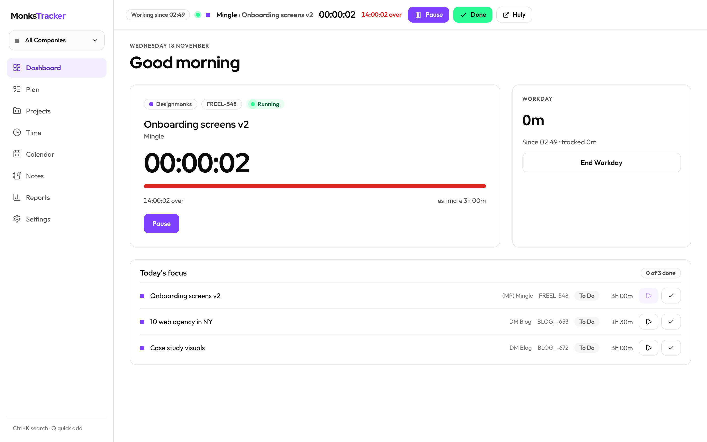

# MonksTracker

A private, local-first work command centre for one designer working across companies: projects, tasks and subtasks, reliable time tracking, workdays, and ready-to-paste office reports.

The full product specification lives in the shared MonksTracker spec document; this repository implements it.

## Layout

| Path | What it is |
| --- | --- |
| `packages/core` | Pure business rules with no I/O: time totals, timer transitions, workday and balance maths, Huly link parsing, estimate parsing, completion %, Discord report generator, first-run defaults |
| `apps/server` | Local server on 127.0.0.1 with the SQLite database, migrations and the HTTP API |
| `apps/web` | The React app: Direction A "Clean Studio" design tokens, app shell, timer bar, dashboard |

## Requirements

- Node.js 22 or newer
- pnpm 10 (`corepack enable` once)

## Commands

```bash
pnpm install
pnpm test          # all unit and integration tests
pnpm typecheck     # strict TypeScript checks
pnpm build         # single-file server at apps/server/dist/server.mjs
pnpm start         # run the built server on http://127.0.0.1:4545
pnpm dev:server    # run the server from source with reload (port 4545)
pnpm dev:web       # run the web app with hot reload on http://127.0.0.1:5173 (talks to the dev server)
```

After `pnpm build`, the server also serves the app itself, so everything lives at http://127.0.0.1:4545.

Sample data for building screens (never mixed into real data; refuses a database that already has projects):

```bash
MONKSTRACKER_DATA=./sample-data pnpm --filter @monkstracker/server seed:sample
```

## Where data lives

`MONKSTRACKER_DATA` if set, else `%LOCALAPPDATA%\MonksTracker` on Windows, else `~/.monkstracker`.
The database is `monkstracker.sqlite`; set a backup folder in Settings for the automatic daily copy.

## Windows: install on your PC

Step-by-step guide: [docs/SETUP-WINDOWS.md](docs/SETUP-WINDOWS.md).

### Start with Windows

After `pnpm install` and `pnpm build`, from the repository folder:

```powershell
powershell -ExecutionPolicy Bypass -File scripts\windows\install-autostart.ps1
```

This adds a hidden-window launcher to your Startup folder and starts the server now.
Remove it with `scripts\windows\uninstall-autostart.ps1` (your data is not touched).

## Design

Direction A, "Clean Studio": white and its shades as the base, colour only as accents with a meaning
(Designmonks purple for actions and focus, mint for done and running, lime and amber as fills with dark text).
All tokens live in `apps/web/src/styles/tokens.css`, in light and dark. The theme follows the time of day
(Settings › theme: `auto`, `light` or `dark`). Fonts and icons are bundled, so the app works offline.



## Rules that the code guarantees

- Time entries are the single source of truth; every total is derived and each entry is counted once.
- Only one work, revision or meeting timer can run at a time (enforced by the database, not just the app).
- A running timer stores only its start time, so refreshes, closed browsers and sleep never lose time.
- Breaks and lunch count in the workday, never in tracked work.
- An entry belongs to the workday it started in, even across midnight.
